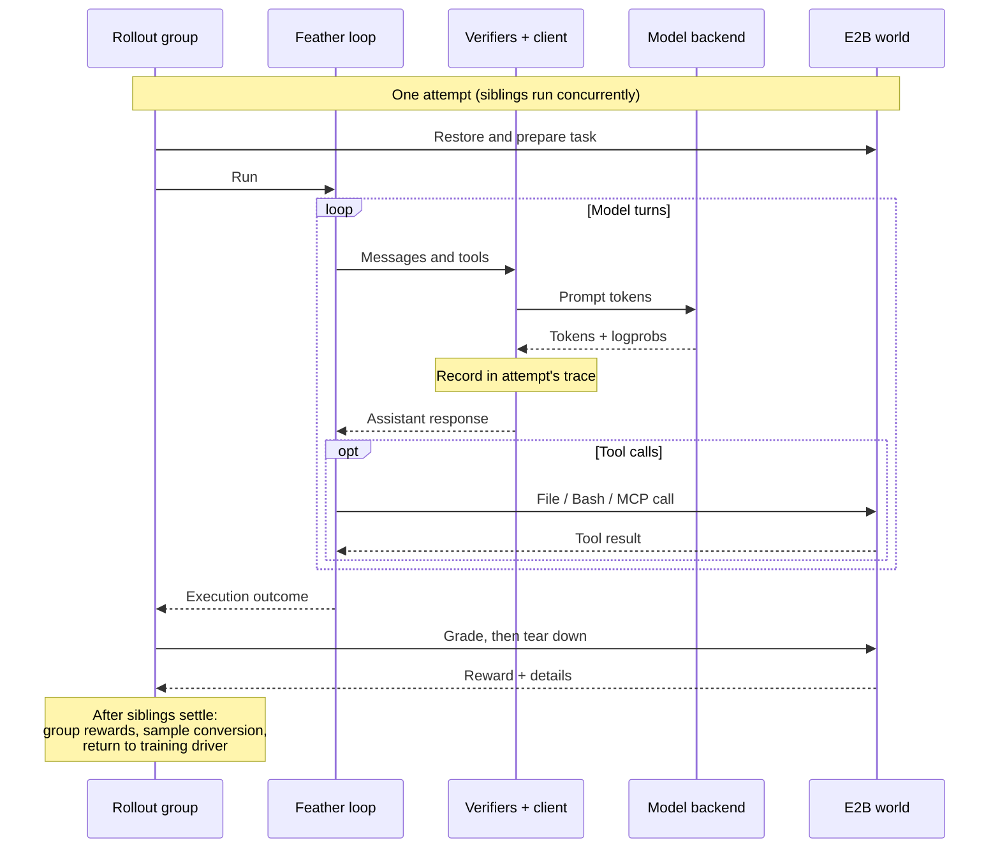

# Rollout architecture

Feather Train runs the agent loop on a coordinator and its tools in an E2B world.
Verifiers captures inference data while the training framework supplies the model
and consumes the resulting samples.

## Components and scope

The coordinator contains shared services, concurrent rollout groups, and independent
rollout attempts. Each attempt owns a corresponding E2B sandbox.

```mermaid
flowchart LR
    subgraph Coordinator[Coordinator]
        direction TB
        Shared["Shared across the run<br/>Training driver and rollout adapter<br/>Verifiers interception · renderer pool"]
        Group["Per rollout group<br/>Sampling client and policy<br/>Group rewards · sample conversion"]
        Attempt["Per rollout attempt<br/>Feather loop · conversation and tool state<br/>Token trace · runtime client · grading"]
        Shared ~~~ Group ~~~ Attempt
    end

    subgraph Sandbox[E2B sandbox - one per attempt]
        direction TB
        Host["E2B host<br/>Collector and saved invocation results"]
        Agent["Agent container<br/>Tool scripts and task filesystem"]
        MCP["MCP containers<br/>Task services and state"]
        Judge["Grader container<br/>Judge and tests"]
        Host ~~~ Agent ~~~ MCP ~~~ Judge
    end
    Coordinator ~~~ Sandbox
```

- **Shared resources:** interception routes each request to its rollout trace and
  group client. A shared renderer pool formats model inputs and parses responses.
- **Per group:** siblings use the group's sampling client and settings. A sampling
  policy can also be shared by multiple groups. Group rewards are calculated after
  siblings settle.
- **Per attempt:** conversation state, tool state, token trace, and sandbox belong
  to that attempt. Retrying a rollout creates a fresh execution and sandbox.

## Rollout data flow

The sequence follows one attempt. The rollout group owns its sampling client;
Verifiers interception and rendering resources are shared. The model backend and
Braintrust are external services.

Braintrust records per-rollout
execution and grading spans, with group and sampling-policy metadata. The
[remote runtime](remote-runtime.md) details tool execution and connection recovery.

## Why these boundaries

- **Fast startup:** worlds are prepared offline from task definitions, including
  Harbor representations, into filesystem/process snapshots. Dependencies and MCP
  services do not need to be rebuilt for each rollout.
- **Isolation:** the loop, model credentials, and host-side services stay on the
  coordinator. Docker Compose separates the agent, MCP services, and peer grader.
  Official Harbor shared mode grades in the solver container; separate mode
  collects declared artifacts into a fresh tests-image verifier. The template
  determines the grading boundary; see [grading](grading.md).
- **Reliable remote tools:** operations execute beside their files, minimizing E2B
  round trips. Saved invocation results allow connection recovery without replaying
  side effects. See [remote runtime](remote-runtime.md).
- **Training bookkeeping:** Verifiers and Renderers preserve sampled tokens across
  turns and distinguish generations from environment content. The agent itself
  does not need training-specific logic.

Harness configuration carries the model prompt budget, sampling settings,
compaction policy, startup profile, optional image reads, and research restrictions
to each attempt. Prompt and per-call usage receipts are recorded in rollout
metadata. Optional benchmark deliverable capture publishes bounded local evidence
before grading isolation; capture failures leave the grading result intact.

## Integrating another training framework

The Tinker recipe demonstrates three integration points:

| Hook | What to supply | Reference implementation |
| --- | --- | --- |
| Rollouts | Connect the framework's rollout interface to Verifiers episodes, passing its current sampling policy and requested group size. | [FeatherRollouts](src/feather_train/recipes/tinker/rollout.py) |
| Inference | Adapt the framework's sampling client to accept prompt tokens and return completion tokens and logprobs. Shared rendering and parsing stay in `RendererClient`. | [TinkerClient](src/feather_train/clients/tinker.py) |
| Training samples | Convert Verifiers' recorded traces and finalized rewards into the framework's sample format. | [Trajectory conversion](src/feather_train/recipes/tinker/trajectory.py) |

Small changes at these boundaries can support other Tinker-style backends or
training frameworks, such as SkyRL, Baseten Loops, and Fireworks. World execution,
agent tools, grading, and rollout logging remain shared.
